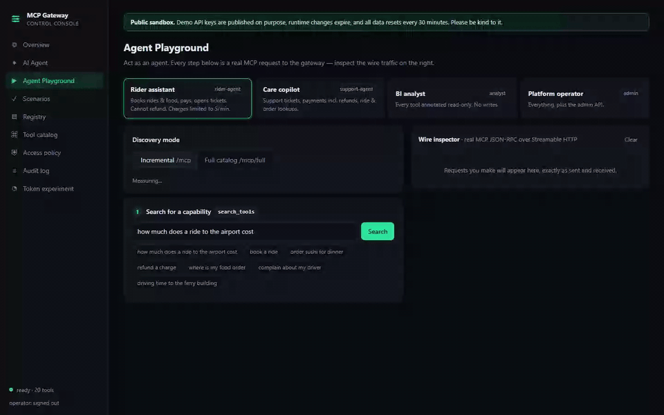
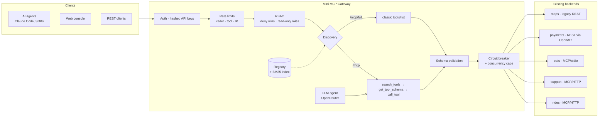
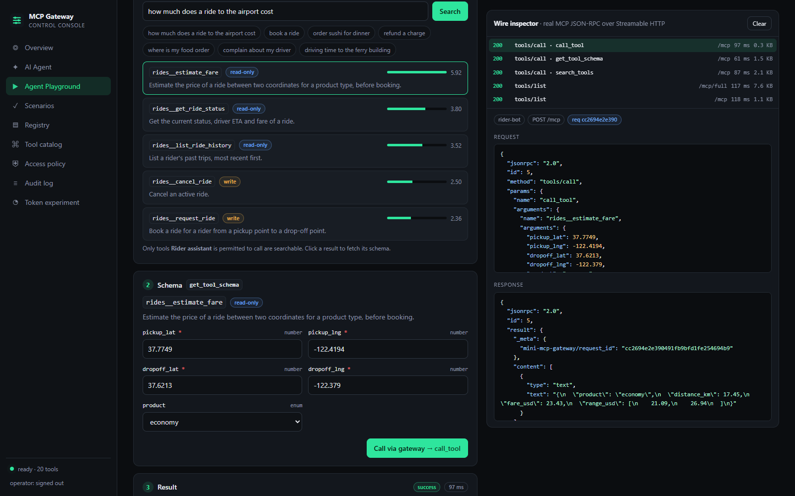
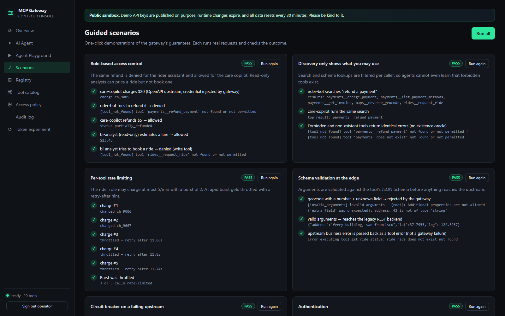
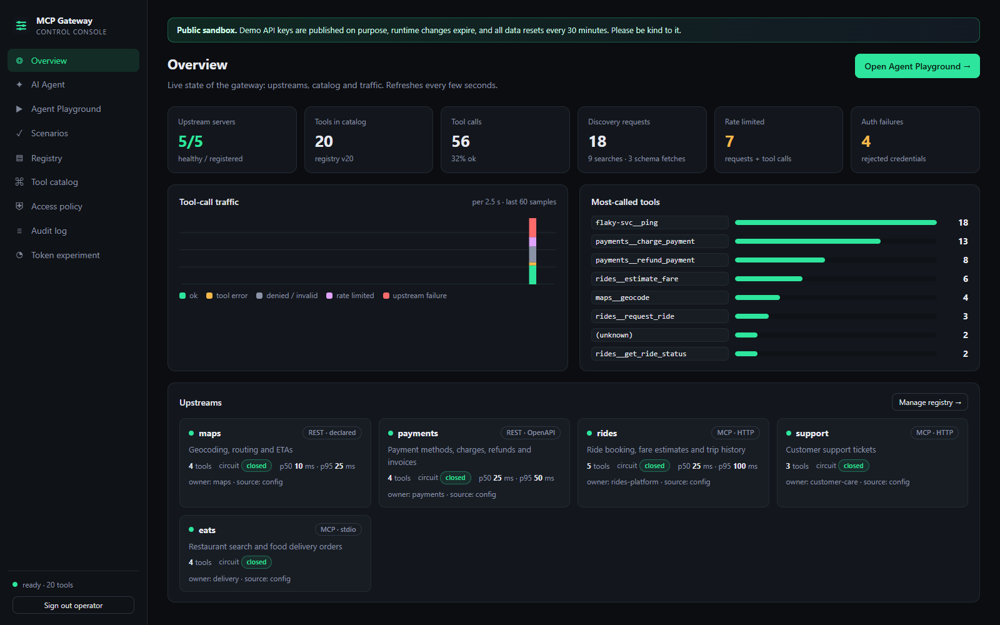
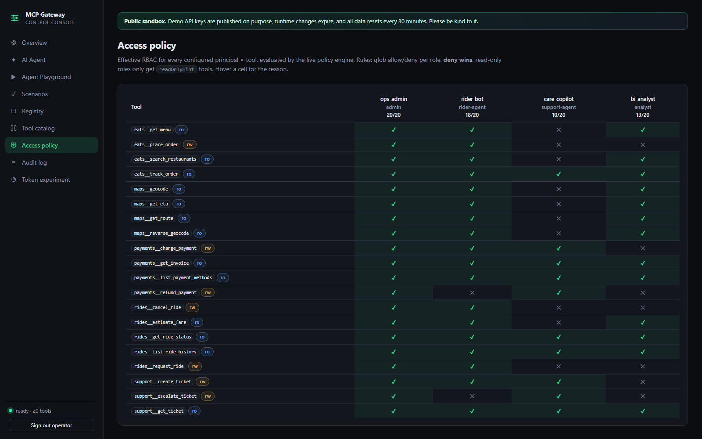

<div align="center">

# Mini MCP Gateway

**One secure front door between AI agents and an organisation's tools — with a registry, RBAC, rate limits,
audit logs, and search-based tool discovery that keeps context cost flat as the catalog grows.**

[](https://github.com/Moksh008/mini-mcp-gateway/actions/workflows/ci.yml)


[](LICENSE)

<!-- Live demo: replace with your deployed URL once it's up (see docs/DEPLOY.md) -->
**[Live demo](#try-it)** · [Architecture](docs/ARCHITECTURE.md) · [Experiment](experiments/results.md) · [Deploy](docs/DEPLOY.md)



</div>

## The problem

Uber's engineering team described it in [*Designing MCP Gateway*](https://www.uber.com/blog/): once hundreds of teams
build MCP integrations independently, tools become hard to **discover**, **secure** and **maintain** — and giving an
agent thousands of tool definitions blows up its context window. Their answer was a central gateway (800+ servers,
5,000+ tools). This project is a compact, working, tested version of that idea that you can run with one command.

## What it does



* **Central registry** — native MCP servers (HTTP or stdio) and **existing REST services bridged with zero code**
  from their OpenAPI spec or a few lines of config. Register, refresh, enable/disable at runtime.
* **Security** — hashed API keys, glob RBAC with deny-wins and read-only roles, per-caller/per-tool rate limits,
  schema validation before anything reaches a backend, upstream credentials injected server-side, SSRF guard.
* **Incremental discovery** — agents get 3 small meta-tools and *search* the catalog instead of loading every
  definition. Search is filtered per caller, so agents can't even learn that forbidden tools exist.
* **Operability** — redacted audit log, Prometheus metrics, health/readiness, circuit breakers, a web console.
* **A real AI agent** — an LLM completes tasks using only the gateway, as a chosen identity, with live provider
  token counts so you can compare discovery modes.

## Results

Measured on the live gateway (20 tools, 5 upstreams). [Full methodology →](experiments/results.md)

| | Full catalog | Incremental (search) |
|---|---:|---:|
| Tool tokens sent on **every** model request | 1,740 | **225 (−87%)** |
| 10 agent tasks, end to end | 40,020 | **31,028 (−22%)** |
| …at 5,000 tools | 749,596 / request | **225 / request** |
| Search finds the right tool (recall@5, with 5,000 look-alike distractors) | — | **100%** |

The honest trade-off: at 20 tools, multi-tool tasks cost *more* with incremental discovery (+6% to +29%) because each
new tool needs a search and a schema fetch. The win grows with the catalog — at Uber's scale full discovery doesn't
fit in any context window, while incremental stays constant. Pinning hot tools (direct calls on `/mcp`) covers the rest.

## Try it

```bash
git clone https://github.com/Moksh008/mini-mcp-gateway.git && cd mini-mcp-gateway
echo "OPENROUTER_API_KEY=sk-or-..." > .env      # optional: enables the AI Agent page
docker compose up --build -d --wait
```

Open **http://localhost:3000**. Agents connect to `http://localhost:8787/mcp`:

```bash
claude mcp add --transport http mini-gateway http://localhost:8787/mcp --header "Authorization: Bearer demo-rider-key"
```

| Demo key | Acts as | Can |
|---|---|---|
| `demo-rider-key` | rider assistant | rides, maps, food, pay, open tickets — **not** refunds; charges limited to 5/min |
| `demo-support-key` | care copilot | support, payments incl. refunds, ride/order lookups |
| `demo-analyst-key` | BI analyst | read-only tools only |
| `demo-admin-key` | operator | everything + admin API |

## The console

| | |
|---|---|
|  |  |
| **Agent Playground** — search → schema → call as any identity, with a wire inspector showing every MCP JSON-RPC message and a live context-cost meter. | **Scenarios** — one-click live acceptance tests: RBAC, discovery isolation, rate limiting, validation, circuit breaker, auth. |
|  |  |
| **Overview** — upstream health, traffic by outcome, latency. | **Access policy** — the live principal × tool matrix with reasons. |

Also: **AI Agent** (watch an LLM work through the gateway, compare modes with real token counts), **Registry**,
**Tool catalog**, **Audit log** (live tail incl. internal denial reasons), **Token experiment**.

## Engineering highlights

* **One code path for agents and clients.** The built-in LLM agent dispatches through the same function as the
  `/mcp` endpoint, so RBAC, limits, validation and audit can't diverge.
* **No existence oracle.** Unknown and forbidden tools return identical errors; the audit log keeps the real reason.
* **Public-demo mode** makes publishing the demo keys safe: per-IP limits with non-spoofable client IPs, self-resetting
  registry, expiring runtime servers, SSRF allowlist, hidden visitor IPs, and hard daily LLM budgets.
  [Threat table →](docs/ARCHITECTURE.md#public-demo-mode)
* **Bugs caught by testing, not users:** nginx silently dropping security headers (`add_header` inheritance),
  unbounded metric labels from unknown tool names, IPv6 loopback misclassified as "reserved" by the SSRF guard —
  each now has a regression test.
* **Tested at three layers:** 76 Python tests (unit + live end-to-end with the official MCP client), strict TS build,
  and a headless-browser suite that drives the real UI against the Docker stack in CI.

## Stack

Python 3.11+ · FastAPI · official MCP SDK (Streamable HTTP + stdio) · Pydantic · SQLite · React 19 + TypeScript + Vite ·
nginx · Caddy · Docker Compose · Playwright · GitHub Actions · OpenRouter (any OpenAI-compatible LLM API)

## Repository

```
mcp_gateway/   gateway (registry, core pipeline, MCP endpoints, search, policy, agent, upstream bridges)
console/       React console, nginx config, Playwright e2e + demo recorder
examples/      5 mock backends (20 tools) and the example config
experiments/   token-usage experiment and results
deploy/        public-demo overlay, production compose (Caddy/HTTPS), env template
docs/          architecture & reference, deployment guide, screenshots
tests/         unit and end-to-end tests
```

Local development without Docker, endpoint reference, security model and configuration:
**[docs/ARCHITECTURE.md](docs/ARCHITECTURE.md)**.

## License

[MIT](LICENSE). Inspired by Uber's engineering blog; not affiliated with Uber. All backends are mocks.
