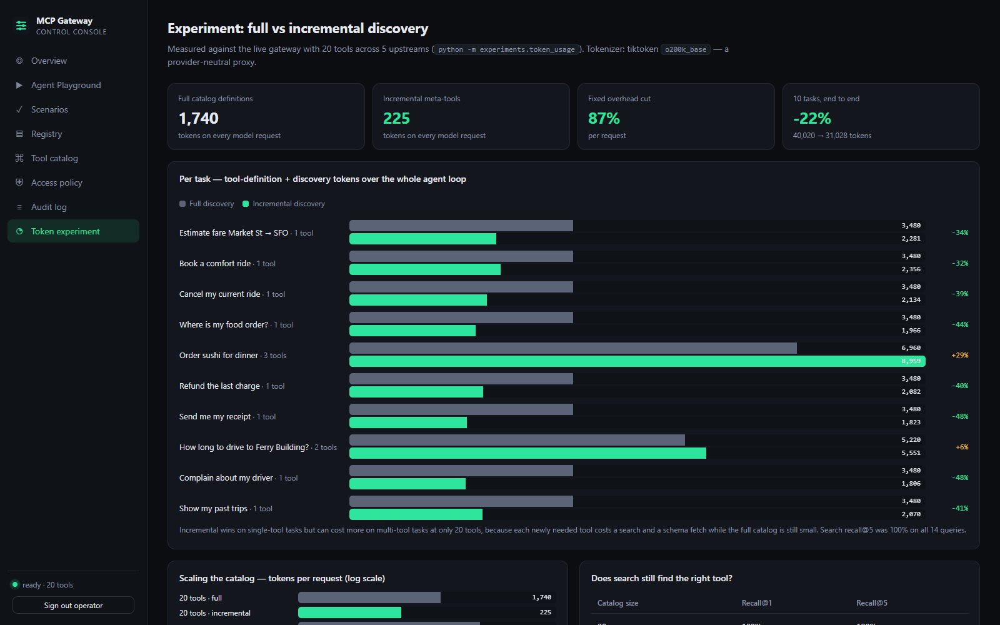
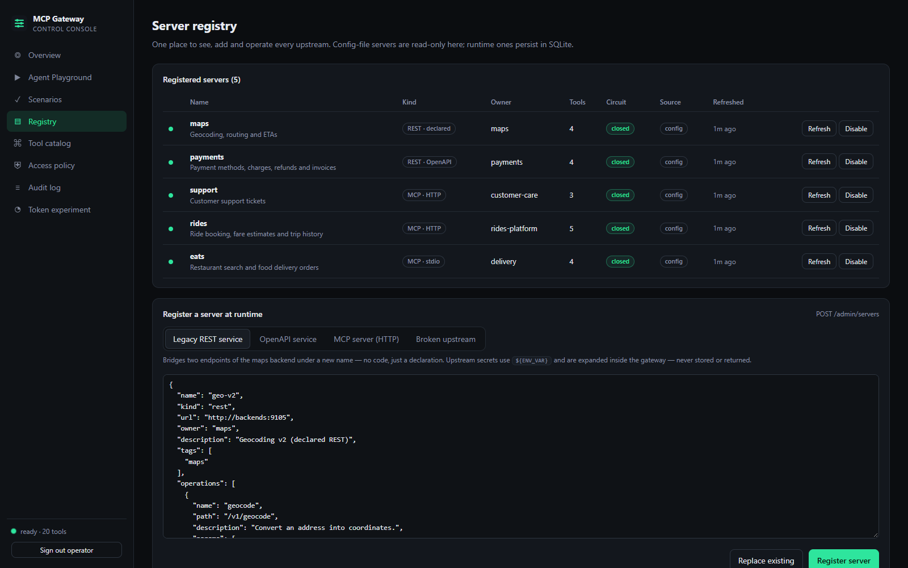
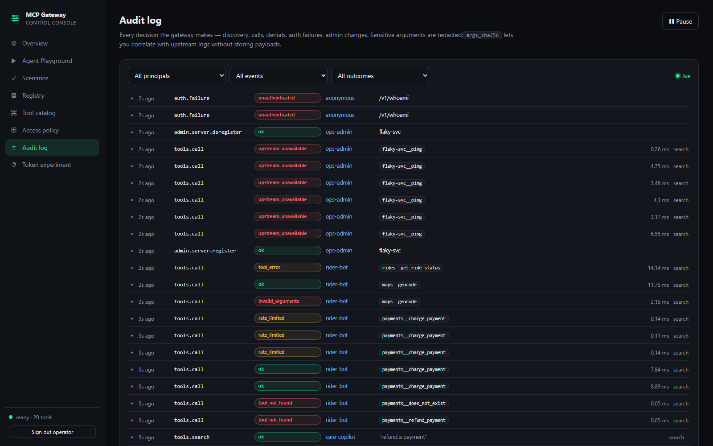

# Mini MCP Gateway

A small, working version of a **central MCP gateway**. It sits between AI agents and an
organisation's tools. It is inspired by the problem Uber describes in
[*Designing MCP Gateway: Uber's MCP Management Platform*](https://www.uber.com/blog/): hundreds of teams were
building MCP integrations on their own, so tools were hard to discover, secure and maintain.

One gateway gives every agent a single endpoint. Behind it:

* a **central registry** of upstream servers: native MCP servers over HTTP or stdio, plus existing REST services
  bridged automatically from OpenAPI or from declared operations
* **authentication** (API keys), **RBAC** over namespaced tools, and **rate limiting** per caller and per tool
* **audit logs** and Prometheus **metrics**
* **incremental tool discovery**: agents search the catalog instead of loading every tool definition into context

```
                          ┌──────────────────────────── Mini MCP Gateway ───────────────────────────┐
  Agents / MCP clients    │  AuthN ─► rate limit ─► RBAC ─► schema validation ─► circuit breaker      │   Upstreams
 ───────────────────────► │                                                                         │ ─► rides    (MCP, HTTP)
  /mcp       incremental  │  ┌───────────┐   ┌──────────────┐   ┌───────────────────────────────┐   │ ─► support  (MCP, HTTP)
  /mcp/full  full catalog │  │ Registry  │──►│ Tool catalog │──►│ Search index (BM25, per-caller│   │ ─► eats     (MCP, stdio)
  /v1/*      plain REST   │  │ (SQLite)  │   │ server__tool │   │ permission-filtered)          │   │ ─► payments (REST, OpenAPI)
  /admin/*   operators    │  └───────────┘   └──────────────┘   └───────────────────────────────┘   │ ─► maps     (REST, declared)
                          │  Audit log (JSONL + ring buffer)  ·  /metrics (Prometheus)  ·  /readyz    │
                          └─────────────────────────────────────────────────────────────────────────┘
```

## Run the whole stack (one machine, one command)

```bash
docker compose up --build -d --wait
```

| | URL |
|---|---|
| **Web console** (operator dashboard + agent playground) | http://localhost:3000 |
| MCP endpoint for agents: incremental / full | http://localhost:8787/mcp · http://localhost:8787/mcp/full |

Three containers on one Docker network: `backends` (4 mock HTTP services), `gateway` (it also spawns the stdio
`eats` server inside its container) and `console` (nginx serving the React app and reverse-proxying the gateway on
the same origin). Health checks gate startup order, and the registry DB and audit log persist in a named volume.
`docker compose down` stops everything; add `-v` to wipe that state.

### The console


Everything in the console is backed by real gateway calls. Nothing is mocked in the browser.

| Page | What it shows |
|---|---|
| **Agent Playground** | Act as any of the 4 demo principals. Search → fetch schema → call, in incremental or full mode. A form is generated from each tool's JSON Schema. The **wire inspector** shows every MCP JSON-RPC request and response, with its request ID. A context meter shows how many tokens each mode makes the model carry, measured from the real responses. |
| **Scenarios** | One-click live acceptance tests: RBAC, per-caller discovery, per-tool rate limiting, schema validation, the circuit breaker on a dead upstream, and authentication. Each step is checked and marked PASS or FAIL. |
| **Overview** | Upstream health, catalog size, traffic by outcome, most-called tools, p50/p95 latency per upstream. |
| **Registry** | Register (from templates or raw JSON), refresh, enable/disable and remove upstream servers at runtime. |
| **Tool catalog** | The merged, namespaced catalog with schemas and annotations. |
| **Access policy** | The live principal × tool permission matrix, with the reason for each decision. |
| **Audit log** | A live tail with filters. It also shows the internal denial reason that callers never see. |
| **Token experiment** | The full vs incremental discovery results, as charts. |

<details><summary>More screenshots</summary>






</details>

Operator pages need an admin key (the sign-in screen offers the demo one). The key is held in that browser tab's
`sessionStorage` only. nginx sends a strict CSP plus `X-Frame-Options`, `nosniff` and `Referrer-Policy`.

## How this maps to the brief

| Requirement | Where |
|---|---|
| Central MCP server registry | `mcp_gateway/registry.py`, `store.py`: config-declared and runtime-registered servers (persisted in SQLite), health, refresh, enable/disable, `tools/list_changed` handling |
| Connect multiple backend APIs | `upstreams/`: MCP over Streamable HTTP and stdio, **OpenAPI → MCP** bridge, declarative REST bridge, in-process tools |
| Discover tools dynamically | Catalog rebuilt on registration, refresh, upstream change notifications and a periodic refresh |
| Authentication and permissions | `auth.py` (hashed API keys), `policy.py` (glob allow/deny, deny wins, read-only roles, admin) |
| Rate limiting and audit logs | `ratelimit.py` (token buckets: per request, per caller, per tool), `audit.py` (redacted, fingerprinted JSONL) |
| Discovery without loading every tool | `/mcp` exposes 3 meta-tools: `search_tools` → `get_tool_schema` → `call_tool` (`mcp_server.py`, `search.py`) |
| Experiment: 20 tools, full vs incremental | `experiments/token_usage.py` → [`experiments/results.md`](experiments/results.md) |

## Experiment results (20 live tools)

Tokens counted with tiktoken `o200k_base` (a proxy; see the [full report](experiments/results.md)).

| | Full discovery | Incremental discovery |
|---|---:|---:|
| Tool-definition tokens on **every** model request | **1,740** | **225** (−87%) |
| 10 realistic agent tasks, total definition + discovery tokens | 40,020 | 31,028 (−22%) |
| Single-tool tasks | 3,480 each | 1,806–2,356 (−32% to −48%) |
| Multi-tool tasks (2–3 tools) | 5,220–6,960 | 5,551–8,959 (**+6% to +29%**) |
| Search recall@5 on the 14 task queries | n/a | 100% |

As the catalog grows (synthetic distractors, half of which reuse the real tools' vocabulary):

| Catalog size | Full: tokens per request | Incremental: tokens per request | Recall@1 | Recall@5 |
|---:|---:|---:|---:|---:|
| 20 | 1,740 | 225 | 100% | 100% |
| 500 | 73,865 | 225 | 92% | 100% |
| 5,000 | 749,596 | 225 | 92% | 100% |

**What this means.** At 20 tools, incremental discovery already cuts the fixed per-request cost by 87%. Tasks that
need several tools can cost *more*, because each new tool needs two discovery round-trips and the whole
catalog is still small. Full discovery grows linearly with the catalog: at the ~5,000 tools Uber reports, the
definitions alone would fill well over any current context window, while incremental stays constant. The cost
you pay instead is search quality and extra round-trips. That is why search returns 5 candidates and why
`/mcp` also accepts direct calls by qualified name, so hot tools can be pinned.

## Local development (without Docker)

Requires Python ≥ 3.11 (and Node ≥ 20 for the console).

```bash
pip install -e ".[dev]"

# terminal 1: four mock HTTP backends (rides, support, payments, maps)
python -m examples.run_backends

# terminal 2: the gateway (it also spawns the stdio "eats" backend)
python -m mcp_gateway serve -c examples/gateway.yaml      # http://127.0.0.1:8787

# terminal 3
python -m examples.client_demo                            # MCP client: full vs incremental flow
python -m experiments.token_usage                         # regenerate experiments/results.md
pytest -q                                                 # 58 tests (unit + live end-to-end)
```

Console in dev mode (proxies to the local gateway on :8787):

```bash
cd console && npm install && npm run dev                  # http://localhost:5173
```

Demo API keys (plaintext `demo-<who>-key`, **demo only**):

| Key | Principal | Role | Can do |
|---|---|---|---|
| `demo-admin-key` | ops-admin | admin | everything + `/admin` |
| `demo-rider-key` | rider-bot | rider-agent | rides, maps, eats, pay/invoice, open tickets. **Not** refunds. Charges limited to 5/min |
| `demo-support-key` | care-copilot | support-agent | support, payments incl. refunds, ride/order lookups |
| `demo-analyst-key` | bi-analyst | analyst | every tool annotated read-only, no writes |

### Connect an MCP client

```bash
# Claude Code
claude mcp add --transport http mini-gateway http://127.0.0.1:8787/mcp \
  --header "Authorization: Bearer demo-rider-key"
```

Any Streamable-HTTP MCP client works. Use `/mcp` for incremental discovery or `/mcp/full` for the classic full list.

### Plain HTTP

```bash
H="Authorization: Bearer demo-rider-key"
curl -H "$H" "localhost:8787/v1/tools/search?q=how+much+does+a+ride+cost"
curl -H "$H" localhost:8787/v1/tools/rides__estimate_fare
curl -H "$H" -H "content-type: application/json" -X POST localhost:8787/v1/tools/maps__geocode/call \
     -d '{"address":"sfo airport"}'
```

## Endpoints

| Path | Auth | Purpose |
|---|---|---|
| `POST /mcp` | key | MCP, **incremental** discovery (`search_tools`, `get_tool_schema`, `call_tool`) |
| `POST /mcp/full` | key | MCP, every permitted tool in `tools/list` (paginated) |
| `GET /v1/whoami`, `/v1/tools`, `/v1/tools/search?q=`, `/v1/tools/{name}` | key | REST discovery |
| `POST /v1/tools/{name}/call` | key | REST invocation (same policy, limits and audit as MCP) |
| `GET/POST /admin/servers`, `GET/DELETE /admin/servers/{name}` | admin | Registry: list, register (`?replace=true`), deregister |
| `POST /admin/servers/{name}/refresh\|enable\|disable` | admin | Registry operations |
| `GET /admin/tools?q=&server=` | admin | Full catalog view |
| `GET /admin/audit?principal=&event=&tool=&outcome=` | admin | Recent audit events |
| `GET /admin/stats` | admin | JSON metrics snapshot (calls by outcome, latency p50/p95, discovery, limits) |
| `GET /admin/policy/matrix` | admin | Effective permission of every configured principal × tool, with reasons |
| `GET /healthz`, `/readyz`, `/metrics` | none* | Liveness, readiness (+ unhealthy upstreams), Prometheus |

\* `/metrics` requires admin when `metrics_public: false`.

Every response carries `X-Request-ID`. A valid incoming one is propagated; otherwise the gateway generates one. The same ID
appears in the audit log and in the tool result `_meta`.

## Design notes

**Namespacing.** Tools are exposed as `<server>__<tool>`, sanitised to `^[a-zA-Z0-9_-]{1,64}$`, the strictest
common provider constraint. Two teams can both ship a `search` tool without colliding.

**Call pipeline** (`core.py`): resolve → authorize → rate-limit (caller, then caller+tool) → JSON-Schema validate
→ circuit breaker + per-upstream concurrency cap → invoke with timeout → bound result size → metrics + audit.
Invalid calls never reach the upstream.

**Security model.**
* API keys are stored only as SHA-256 digests and compared in constant time. `mcp-gateway gen-key` mints them.
* Unknown tools and forbidden tools return the *same* error, so callers can't probe for tools they can't use.
  Search and `get_tool_schema` only ever show tools the caller may call. The audit log records the real reason.
* Upstream credentials (e.g. `Authorization: Bearer ${PAYMENTS_API_TOKEN}`) are expanded from the environment at
  connect time. They are never stored in the registry DB or returned by any API, and agents never see them.
* Read-only roles rely on MCP `readOnlyHint` annotations. REST bridges infer them (GET = read-only), and OpenAPI
  operations can override with `x-mcp-read-only` / `x-mcp-destructive`, or opt out with `x-mcp-exclude`.
* Runtime registration of `mcp_stdio` servers is off by default, because it would mean running an arbitrary
  command on the gateway host. URLs must be http(s), and `upstream_host_allowlist` limits SSRF.
* Audit arguments are redacted by key (`card_number`, `token`, `password`…), truncated, and fingerprinted
  (`args_sha256`). That lets you correlate calls with upstream logs without storing payloads.
* Upstream 4xx responses come back to the agent as tool errors, because they are meaningful ("charge not found").
  5xx responses, timeouts and connection failures count toward the circuit breaker.

**Resilience.** Each MCP upstream has a supervisor task that owns the session, pings it, and reconnects with
exponential backoff. A failed refresh keeps the last known-good catalog. Both MCP endpoints are stateless
(Streamable HTTP, JSON responses), so replicas can sit behind any load balancer.

## Configuration

See [`examples/gateway.yaml`](examples/gateway.yaml) for a fully commented example covering all five upstream kinds,
roles, keys and limits. Endpoint URLs accept `${VAR:-default}`, and `MCPGW_CONFIG`, `MCPGW_HOST` and `MCPGW_PORT`
override the basics. Validate a config with `python -m mcp_gateway check-config -c <file>`.

## Testing

Three layers:

* `pytest -q`: **58 Python tests** (details below).
* `npm run build` in `console/`: strict TypeScript typecheck plus production build.
* `python console/e2e/ui_smoke.py --url http://localhost:3000`: drives the **real UI in a headless browser** against
  the running Docker stack. It covers the playground flow, every operator page, all 6 scenarios (they must PASS),
  registering and removing a server through the UI, and it fails on any browser console error, including CSP
  violations. CI runs this against `docker compose` on every push.

`pytest -q` runs **58 tests**:
* **Unit tests:** policy, token buckets, auth, config, audit redaction, circuit breaker, search ranking, OpenAPI
  conversion (refs, cycles, exclusions), result truncation, metrics.
* **End-to-end tests:** real uvicorn servers for every upstream kind behind a real gateway, driven by the official MCP
  client. They cover RBAC filtering in both discovery modes, the search→schema→call flow, the existence-oracle check,
  read-only roles, schema validation, stdio upstreams, credential injection, per-tool rate limits (MCP and HTTP 429),
  runtime register/replace/disable/deregister with persistence, admin guards, circuit breaking on a dead upstream,
  the audit trail, metrics (including bounded label cardinality), the stats/policy-matrix APIs, and 40 concurrent
  mixed-principal calls.

## What production would add next

The Docker stack is a complete single-machine deployment. Running **several gateway replicas** is the next step,
and these are the parts that are deliberately single-node today:

* **Shared state for multiple replicas.** Rate limits are in-memory (the `RateLimiter` protocol is the seam for Redis).
  The registry uses SQLite (swap in Postgres). The audit sink should go to Kafka or a log pipeline.
* **Identity.** Use OIDC/JWT and mTLS for service callers, and do per-user OAuth token exchange to upstreams instead
  of one shared upstream credential.
* **Search.** Use a hybrid lexical + embedding ranker, learned from usage logs (which searches led to which calls).
* **Governance.** Add an approval workflow for new servers, schema-change diffing, tool-description linting, and
  per-tool owners and SLOs.
* **Observability.** OpenTelemetry traces across gateway and upstreams. Today a request ID is propagated and
  Prometheus metrics are exported.

## Project layout

```
mcp_gateway/        gateway package (≈2.7k LOC)
  app.py            ASGI app, auth middleware, REST + admin APIs
  core.py           call pipeline and discovery
  mcp_server.py     /mcp (incremental) and /mcp/full endpoints
  registry.py       registry, catalog, circuit breaker
  search.py         BM25F tool search
  upstreams/        MCP (HTTP/stdio), REST, OpenAPI, in-process
console/            React + TypeScript web console (Vite), nginx config, Playwright e2e
examples/           mock backends (20 tools), gateway.yaml, client demo
experiments/        token-usage experiment + results
tests/              unit and end-to-end tests
docs/screenshots/   generated by the UI e2e run
docker-compose.yml  backends + gateway + console on one machine
```

MIT licensed. Not affiliated with Uber; the backends are mocks.
